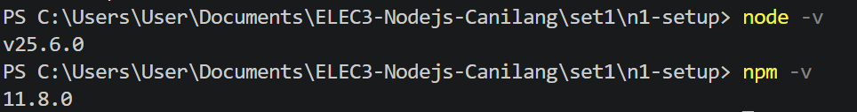
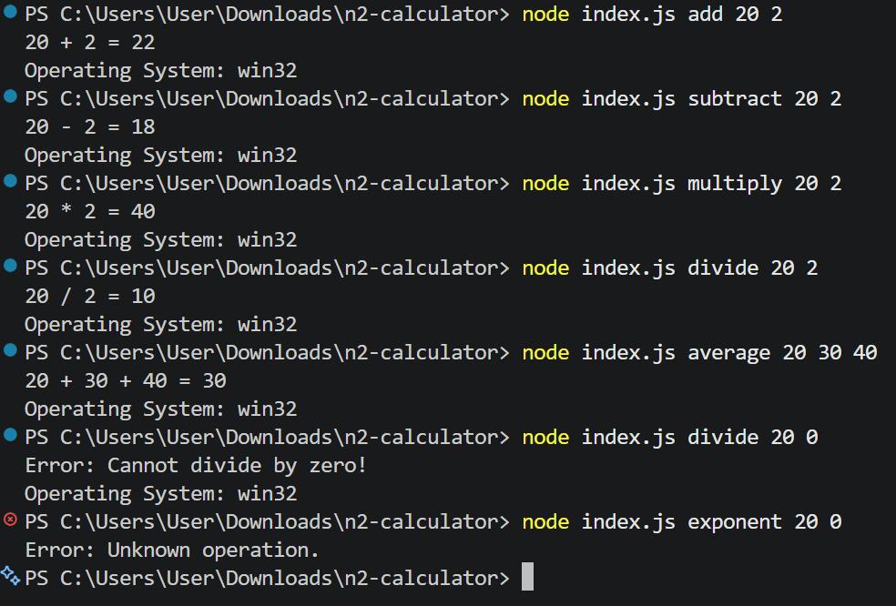
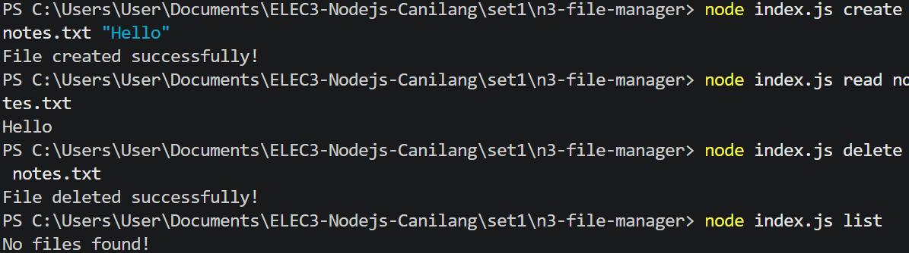

# ELEC 3 – Node.js

**Name:** Harold Canilang
**Section:** IV-BSIT-A
**Course:** ELEC 3 – Node.js
**Instructor:** Carl Gustaf Patrik B. Ferrer

This repository contains my outputs for the Self-Paced Learning Assignment (Set 1; Set 2 will be added after it is finished).

## Activities

### Set 1

| Activity | Description | Folder |
|---|---|---|
| N1 | Project setup, npm, and `package.json` | [set1/n1-setup](set1/n1-setup) |
| N2 | Modular calculator using `require()` and `module.exports` | [set1/n2-calculator](set1/n2-calculator) |
| N3 | File manager using `fs` and `path` | [set1/n3-file-manager](set1/n3-file-manager) |

## How to Run

Run `npm install` first inside each activity folder (dependencies are not committed).

| Activity | Commands |
|---|---|
| N1 | `cd set1/n1-setup` → `npm install` → `npm start` |
| N2 | `cd set1/n2-calculator` → `node index.js add 12 8` (or `node index.js average 90 85 80`) |
| N3 | `cd set1/n3-file-manager` → `node index.js create notes.txt "Hello"` (also: `read`, `update`, `delete`, `list`) |

## Screenshots

### N1

### N2

### N3

